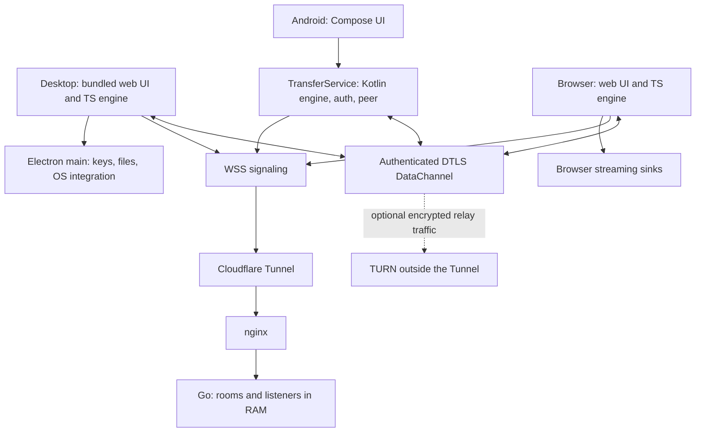

# StreamDrop: architecture and delivery plan

2026-11-06. Planning baseline: local commit `75ef921`. This document replaces the remaining work in `plan_3.md`; it does not replace [the wire specification](docs/protocol.md).

Evidence labels apply to each paragraph, list item or table row. **[code]** means inspected repository code, not proof that it works on every platform. **[measured]** means a result recorded in [track.md](track.md), not a new test in this planning session. **[docs]** means current external documentation, linked next to the claim. **[unverified]** marks a proposal, estimate, inference or unresolved condition. Proposed behaviour is not described as shipped behaviour.

**[unverified]** Recommended release contract: a private beta first; apps remember devices; the website handles one-off transfers. Android receives a waiting call when opened, and continues an active transfer in a foreground service. Pocketed, unattended reachability is deferred. Windows, macOS and Linux remain product targets, but each earns its own release gate. Owner choices remain open in section 12.

## 1. Decisions

| Area | Decision | Main reason and evidence |
|---|---|---|
| Desktop | Keep Electron and the bundled web UI | **[code]** [main.js](desktop/main.js), [app.ts](web/src/app.ts) already reuse the TS connection and transfer engines. **[measured]** Linux restart recovery passed; other systems have not. |
| Android | Kotlin, Compose, native libwebrtc; retain `Auth.kt`, replace the spike | **[measured]** Pixel 7a moved 2 GiB both ways with a 153 MiB peak process footprint. **[code]** [SpikeService.kt](android/app/src/main/java/xyz/kurohane/streamdrop/SpikeService.kt) lacks the product engine, UI and reconnect. |
| Protocol | Keep v2, min 1; fix durability and validation without changing framing | **[code]** [protocol](docs/protocol.md) already supports per-file resume and additive extensions. **[unverified]** No core feature here needs a breaking wire change. |
| Trust | One secret per device pair, fingerprint-bound proof on every connection | **[code]** [auth.ts](web/src/auth.ts), [saved.ts](web/src/saved.ts), [Auth.kt](android/app/src/main/java/xyz/kurohane/streamdrop/Auth.kt). **[unverified]** Public release requires outside review. |
| File concurrency | Many queued files; one streaming file per direction on each connection | **[code]** [transfers.ts](web/src/transfers.ts). **[unverified]** This meets simultaneous sending and receiving without parallel outbound streams or their extra memory. |
| Restart recovery | Persist queue, durable receive offsets and completion receipts locally | **[code]** Current saved records omit offered and completed rows. **[unverified]** Extend the local format before claiming complete restart survival. |
| Android reachability | Open app to answer; service for active work; no FCM in first release | **[unverified]** Smallest architecture with no server device registry. It does not promise wake from force-stop or unlimited background reception. |
| Website | Temporary connections only; capability-based file limits | **[code]** [sinks.ts](web/src/sinks.ts) has quota and memory fallbacks. **[unverified]** Do not promise 20 GiB or restart recovery on every browser sink. |
| Server | Keep one memory-only Go process behind the existing tunnel and nginx | **[code]** [main.go](server/main.go), [deployment files](deploy/nginx-streamdrop.conf). **[unverified]** No database, accounts, discovery broadcast or server transfer queue. |
| TURN | Keep off initially; enable only after network failures and budget enforcement tests | **[measured]** One LTE path worked without relay. **[unverified]** That is insufficient evidence for public internet reachability. |
| Stored mode | Keep off, outside the core product | **[code]** Optional disk storage already exists. **[unverified]** It changes the no-server-storage promise and still needs a Cloudflare terms decision. |
| Several devices | Save several pairs; connect to one at a time in v1 | **[code]** Listener supports 32 ids per socket. **[unverified]** Expose that limit instead of silently dropping device registrations. |
| Release delivery | Signed installers/APK, visible update check first; automatic installation later | **[code]** No updater exists. **[unverified]** A tested security-update path is mandatory before public release. |
| UI | Keep the existing token system and symmetric screens | **[code]** [index.html](web/index.html), [style.css](web/src/style.css). **[unverified]** Native Compose maps the same values; no dynamic Material palette. |

## 2. Baseline, corrections and hard limits

**[measured]** The last recorded suite passed Go race tests, 78 web unit tests, 17 desktop file tests, 12 Electron e2e, 38 web e2e and 11 Kotlin vector tests. The Android interop suite also ran. These counts come from [the progress log](track.md); no suites were rerun for this document. Linux SIGKILL recovery was demonstrated at 300 MiB. Pixel Wi-Fi throughput was 18.3 MiB/s receiving and 12.0 MiB/s sending; LTE was one 8 MiB sample at 0.3 MiB/s. None establishes 20 GiB reliability.

| Finding | Consequence |
|---|---|
| **[code]** `Saved` and `persist()` in [transfers.ts](web/src/transfers.ts) omit offered rows, completed receipts, batch and relative-path metadata | **[unverified]** Persist the whole app queue. A transfer that has not started must survive restart too. Keep completion receipts separately from visible history. |
| **[code]** Finished `resume` is answered with `saved` only while the engine still has the completed row | **[unverified]** Receiver restart or Clear finished can otherwise make a successfully received file appear failed. Persist receipts before acknowledging completion. |
| **[code]** [desktop/files.js](desktop/files.js) syncs file data, but its sidecar and [main.js](desktop/main.js) JSON records use write plus rename without syncing the JSON file/directory | **[unverified]** SIGKILL success is not a power-loss durability guarantee. Add ordered record commits and crash injection at every boundary. |
| **[code]** `createSender.ack()` accepts any number; `parseFrame()` imposes no payload maximum; the auth gate limits held message count, not total bytes | **[unverified]** Validate monotonic bounded ACKs, frame/control size and aggregate queued bytes on both engines. A message count alone does not bound memory. |
| **[code]** `inside()` is lexical; receiving creates directories and renames through filesystem paths | **[unverified]** Add symlink/reparse-point checks and race tests. A lexical prefix test alone does not prevent writes through an existing symlink. |
| **[code]** The Kotlin gate exposes a timeout callback; the spike schedules one timeout from startup, rather than rearming a full proof timeout after hello | **[unverified]** Preserve crypto but give the product adapter explicit hello/proof timers matching the specification. Test late hello and early buffered messages. |
| **[code]** The spike advertises `save`, although it cannot persist pairs; it also ignores the supplied TURN list in `makePeer()` | **[unverified]** Product caps must reflect installed storage capability; product peer configuration must consume signaling ICE servers. Do not reuse spike behaviour here. |
| **[code]** Desktop package targets are NSIS, DMG, AppImage and deb; its `dist` script builds Linux only | **[unverified]** MSIX and automatic updates are new delivery work, not configured features. |
| **[code]** README still says Android is untested and its folder description is browser-specific; [track.md](track.md) records later Android measurements and desktop folder support | **[unverified]** Rewrite platform capability claims at release; trust code and dated results over the broad README wording. |

**[unverified]** Resolve three impossible universal promises explicitly. A browser memory sink grows with file size, so bounded-memory 20 GiB support applies only to streaming storage paths. Android cannot guarantee autonomous revival after a user force-stop. A six-hour background service budget cannot finish every 20 GiB transfer uninterrupted: at the measured LTE rate, 20 GiB would take roughly 19 hours, assuming that rate held. Resume, reopen and honest limits are required; do not lower the file-size limit to conceal them.

**[docs]** Android documents a six-hour `dataSync` background allowance per 24 hours for apps targeting Android 15+, with a timeout callback and reset on foreground interaction. [Foreground service timeouts](https://developer.android.com/develop/background-work/services/fgs/timeout). **[unverified]** Verify the exact behaviour on the Pixel's Android 17 build and current target SDK before release.

## 3. Whole-system architecture and failure behaviour

**[code]** The current boundaries are shown below. **[unverified]** Android's product modules and persistent queue are the planned additions.

**[unverified]** Each client exposes three independent adapters: `Connection` handles discovery, signaling and reconnect; `AuthGate` is the only path into an authenticated connection; `TransferEngine` handles per-file state and calls `Source`, `Sink` and `Journal`. UI subscribes to state and sends commands. Storage adapters return success only after the promised operation finishes. No UI activity owns a socket or file descriptor on Android.

**[code]** Saved rendezvous uses one listener socket, up to 32 pair room ids, and a separate call socket. Both devices listen on the same id. The server keeps the latest four sockets per id, rings each at most every five seconds, and reports `listeners:n`, including the caller. See [hub.go](server/hub.go). **[unverified]** Never present that count as verified online presence: ghosts, duplicates and busy devices make it only a hint.

**[unverified]** Saved-device flow: select device; open `rejoin(roomId)`; ignore self-rings; the other app opens its own call socket; first arrival offers; both run the proof; restore pending work; offer files; receiver accepts; stream and acknowledge; commit destination; send `saved`. Close after two idle minutes only when no unfinished offers or transfers remain. Keep keys and history. If the phone app was closed, opening it registers `listen` and picks up a call still waiting in the ten-minute room. Beyond that, the caller must retry; there is no offline mailbox.

| Event | Planned response **[unverified]** |
|---|---|
| Brief `disconnected` | Freeze reads/sends and show Reconnecting; allow a proposed 5-second recovery grace. If recovered, continue the same channel; otherwise checkpoint and recreate. Tune by real tests. |
| Channel closed, ICE failed, or confirmed network replacement | Drain bounded disk writes; close old peer; reconnect with a fresh generation id so stale callbacks cannot mutate the new connection. Authenticate again, then use receiver offsets. |
| Wi-Fi to mobile data | `ConnectivityManager` observes validated default-network changes. Debounce flapping; recreate socket and peer as needed. Do not bind permanently to Wi-Fi. Port the successful policy back to TS. |
| Signaling lost while channel works | Let bytes continue; reconnect the idle listener independently. Rebuild signaling when the file channel needs recovery. |
| Server restart or room full from stale socket | Jittered exponential retries, 1 to 30 seconds for calls; cap each attempt's connect/auth time. Allow ghost cleanup (45-second ping plus 15-second timeout) before declaring failure. |
| Auth failure | Close; preserve partial data; enforce at least 30 seconds per-device cooldown; no automatic downgrade or endless proof retry. Offer reconnect or remove/re-pair. |
| Source missing or grant revoked | Preserve receiver progress. Ask to choose/share the same file again; validate identity before using its old id. |
| Disk full, read-only volume, pending item deleted | Stop that file with a plain reason; preserve recoverable state. Require space or a new destination before continuing. Never report Received early. |
| User Cancel / Disconnect | Commit cancellation/tombstone first; stop streams and notify other side best effort. Disconnect explicitly offers Keep unfinished or Discard; no silent destruction on a network error. |
| Timeout or OS stops Android | Checkpoint proactively; release resources; stop service promptly on timeout. Next allowed start or app open resumes. User force-stop requires opening the app. |

**[unverified]** Reconnect deliberately creates a new peer rather than adding an ICE-restart signaling dialect in v1. It reuses the existing tested `rejoin` and auth flow. Keep a single retry owner, cancel timers on explicit stop, and prevent simultaneous call attempts to the same room. A five-second grace is an experiment, not an established best value.

## 4. Protocol, compatibility and local records

**[code]** Keep [protocol.md](docs/protocol.md) authoritative: compact JSON with `t` first; one ordered reliable channel named `file`; 26-byte transfer id prefix; payload up to 64 KiB subject to the negotiated maximum; 16 MiB unacknowledged window; 4/1 MiB send buffer thresholds; approximately 1 MiB ACKs; 20 GiB per file; batches up to 500 with at most 100 unanswered offers. `rel` is optional and old receivers flatten it. `save` is offered only with secure persistent key storage. `pair`/`saved` describe this connection, not generic capabilities.

| Change **[unverified]** | Wire/version impact | Compatibility test |
|---|---|---|
| Durable queue, receipts, source staging, reconnect grace, stronger limits | Local implementation; keep v2/min1 | Existing v1 ad hoc and v2 clients still exchange the same messages |
| Decline all remembers batch rejection for later offers | Local state; reuse `reject` per arriving offer | 500-file batch against old and new senders ends with every file declined |
| App pause/resume controls | Local sender pause for initial UI; receiver pause stays Cancel until specified | Do not send an invented `pause` to old clients; connection-loss pause already works |
| Future remote per-file pause | Add `pause` capability plus explicit pause/resume control specification; keep v2 only if optional | Only use after both advertise capability; older clients keep existing UI |
| Optional release/version health metadata | HTTP endpoint or static release manifest, independent of transfer version | Old clients ignore it; malformed response cannot affect keys or files |
| Future breaking crypto/framing change | Raise `v`; raise `min` only when dropping old version | Both ends display update message; saved connections never fall back |

**[unverified]** Document stricter validation as implementation requirements: integer ACK in `[previousAck, bytesSent]`; receiver offsets in `[0,size]`; maximum frame and control size; batch consistency; no duplicate id repurposing; bounded UTF-8 input; bounded message and byte queues. Reject hostile peers without unbounded allocation. Maintain headroom for valid 64 KiB payload plus 26-byte id; subtract the prefix from the transport maximum. Distinguish graceful connection loss from invalid messages.

**[unverified]** Local JSON schema v2: journal generation, schema version, room/pair reference, authentication requirement, creation/update time; item id, direction, state, name, size, MIME, opaque fingerprint, batch, relative path, source reference, sink reference, durable offset and finalization state. Pair records store wrapped `K`, local display name, created/last-seen time and acceptance policy. Never serialize plaintext `K` in a transfer journal. Treat local records as untrusted on load and reject unsupported future schemas without deleting them.

**[unverified]** Durable checkpoint order: write file bytes; sync file; write new JSON to a private temp file; sync temp; atomically replace journal; sync parent directory where supported. Serialize commits. On restart validate length and offset, truncate excess bytes, and report only the durable offset. Checkpoint every 64 MiB and at pause/finalization; record offers/acceptances immediately. This allows replay of up to one checkpoint interval after a crash without duplicating output.

**[unverified]** Finalization is a small transaction: mark finalizing durably; sync complete data; allocate a collision-free final destination; publish/rename; persist a completion receipt; then send `saved`. Recovery reconciles final path or MediaStore URI with the journal. A crash after publishing but before receipt must not create a second copy or lose the acknowledgement. Receipts contain pair/connection identity, id, fingerprint, size and outcome, not file bytes. Keep them while a restartable transfer can remain pending; propose 30 days, explicitly expire unfinished work at the same horizon. Clear finished hides UI rows without deleting receipts. Cancellation tombstones prevent resurrecting discarded transfers.

**[code]** Current desktop cleanup deletes unopen partials after 24 hours; browser OPFS cleanup also uses 24 hours. **[unverified]** Retain the browser's documented 24-hour policy. Replace app age-only cleanup with journal-aware cleanup, showing the app recovery expiry before deletion. Android MediaStore expiry can shorten that promise; see below. Recovery after arbitrary months is not promised.

## 5. Android implementation

### Modules and threading

| Proposed module **[unverified]** | Responsibility |
|---|---|
| `protocol/` | Pure Kotlin models, validation, ordered serializers, vectors, transfer state machine; no Android classes |
| `connection/` | OkHttp signaling, libwebrtc adapter, auth timers, call generations, retry policy, network observer |
| `storage/` | SAF sources, optional spool, MediaStore sink, atomic journal, Keystore wrapper, recovery reconciler |
| `service/TransferService` | Owns all live resources and commands; foreground lifecycle; notifications; timeout and shutdown |
| `ui/` | Compose screens and ViewModels observing immutable `StateFlow`; no transfer work in composition |
| `share/`, `pairing/` | Share intents and URI grants; camera QR; code/link input; mutual save flow |

**[unverified]** One serialized coroutine dispatcher owns connection and engine state. libwebrtc/OkHttp callbacks copy only bounded input and enqueue events. One bounded disk writer handles incoming writes in order; one source worker reads the current outbound file. UI runs on the main dispatcher. Use `Long` offsets throughout. Dispose channel, peer and factory deterministically; cancel source reads and close descriptors on stop. Start the gate exactly once on the first received message or OPEN, whichever comes first.

**[unverified]** Allocate reusable 64 KiB source buffers. Copy libwebrtc callback buffers before returning, but acquire a byte-budget slot before queueing; do not queue an unbounded list of copied callbacks. Limit total receive backlog to 32 MiB plus bounded control overhead, and transport buffering to the 4 MiB policy. Serialize outgoing disk reads. Block neither callback thread nor UI on filesystem sync. A full queue or invalid frame closes the offending connection safely. Memory targets are acceptance criteria in section 8, not results.

### Sources and destinations

**[docs]** SAF lets users choose documents without broad storage permissions; persistable grants are available through appropriate document intents. Providers may report unknown sizes. [SAF guide](https://developer.android.com/training/data-storage/shared/documents-files). **[unverified]** Use `ACTION_OPEN_DOCUMENT` with multiple selection and request persistable read grants when offered. Never assume every `content://` descriptor is a seekable file or a permanent grant.

| Source **[unverified]** | Policy |
|---|---|
| Known-size, seekable, reopenable URI | Stream directly. Persist URI grant and stable fingerprint information. Recheck before resume. |
| Known-size, non-seekable provider | Default to a private disk spool for reliable resume; stream copy with progress and cancellation. A linear skip can be offered for a reopenable stable stream, but can be as slow as reading the entire prefix. |
| Unknown size | Stage to app-private disk before `meta`; count bytes and hash while copying; stop over 20 GiB or on low disk. Show Preparing file with bytes, not fake percent. Protocol cannot send unknown length. |
| Share-sheet temporary grant | Copy into a durable spool before promising process-death resume, or show Choose this file again if staging was declined/interrupted. Do not assume temporary grants become persistable. |
| Source changes | Revalidate on reopen; stage mutable/cloud sources to an immutable snapshot when reliability requires it. Never splice a changed source onto old receiver bytes. |

**[unverified]** Spooling is local disk, not RAM or server storage. It adds up to one source file of disk use and preparation time. Reserve space conservatively, recheck during writes, clean cancelled spools and retain active ones by journal reference. Prefer sequential preparation to avoid 500 concurrent source reads. The UI says when local space is insufficient rather than quietly dropping restart guarantees.

**[code]** Current TS fingerprints hash size, timestamp, first and last MiB; middle-only changes can pass. `fp` is opaque to the receiver. **[unverified]** Kotlin may use a full streaming SHA-256 from its spool without a wire change. For direct sources use the existing algorithm for matching, but state its limitation; add mutation tests. A full integrity/hash extension is review work, not something already provided by the sampled fingerprint. Independent whole-file hashes remain the test oracle.

**[unverified]** Receive into an app-owned `MediaStore.Downloads` row under `Download/StreamDrop`, using sanitized names, validated subdirectories, collision-safe allocation and `IS_PENDING=1`. Reopen by URI, not guessed filesystem path. Check actual seek, truncate and sync behaviour on API 29 and current Android. If the provider cannot supply a durable seekable sink, choose a private spool and stream into a new pending row at completion; disclose the extra disk requirement. Never send `saved` until publishing succeeds.

**[docs]** MediaStore automatically derives `DATE_EXPIRES` from pending state; pending expiry is typically seven days, and expired items can be deleted during idle maintenance. It is not an indefinite reservation. [MediaColumns](https://developer.android.com/reference/android/provider/MediaStore.MediaColumns#DATE_EXPIRES). **[unverified]** Query and record actual expiry. On launch reconcile journal references, missing rows and lengths. Warn before expiry; recreate a missing sink and resume at zero only with a clear restart notice. Do not promise a 30-day resume for a pending row that expires sooner. Remove orphan pending rows after reconciliation; never delete unrelated Downloads.

### Service, permissions and saved devices

**[unverified]** A visible activity starts/binds the service. Promote to `dataSync` foreground service before opening an external picker or starting transfer preparation/transport. While app-visible and idle, the service can own the listener without an indefinite foreground promise; stop the idle listener when leaving the app unless actively waiting on a user-started call. Stop foreground work after idle close or cancellation. On OS-permitted process recreation reload the journal and resume; on force-stop, service budget exhaustion or boot, require app open. No boot receiver in v1.

**[docs]** Foreground service types must match actual work; `specialUse` requires a declared explanation, and it is not an automatic approval for an always-on socket. [Service types](https://developer.android.com/develop/background-work/services/fgs/service-types). Doze restricts network and wake locks; a foreground service must not be treated as a universal exemption. [Doze guide](https://developer.android.com/training/monitoring-device-state/doze-standby). **[unverified]** Hold a bounded partial wake lock only for preparation/active bytes; add Wi-Fi locking only if real tests justify it. Checkpoint before timeout rather than hoping a last-second sync finishes.

**[unverified]** Do not include Stay reachable or FCM in the first release. If pocketed receipt is required, run a separate feasibility milestone: opt-in listener, correct service classification and Play review, 24-hour unplugged tests on Pixel plus another maker, proposed extra battery budget under 3 percentage points/day, and visible Stop. FCM needs a wake routing design: an opaque id alone cannot wake a device without a reachable token mapping or token supplied by the caller. The previous plan's claim that tokens can simply be unstored is incomplete. Design token rotation, authentication, spam resistance, Google metadata and force-stop behaviour before choosing it; high-priority pushes must follow current FCM policy. This work changes the no-registry assumption and estimate.

**[unverified]** Wrap each pair `K` with an app Keystore AES-GCM key, fresh nonce and schema/pair binding as associated data. Keep wrapped records in private non-backup storage; exclude keys, journals and URI references from backup/data extraction. Missing/invalidated Keystore key means re-pair, not plaintext fallback. Do not require biometric authentication for every transfer if autonomous resume is the product contract. Test locked-screen access and device reboot before claiming it. Advertise `save` only after secure storage is usable.

**[docs]** Notification permission denial does not itself prohibit starting a foreground service; its notice remains in Task Manager rather than the notification drawer. [Notification permission](https://developer.android.google.cn/develop/ui/compose/notifications/notification-permission?hl=en). **[unverified]** Request permission after explaining incoming offers, never block transferring on refusal. Show an in-app banner linking to settings. Group batch offers, provide Accept/Decline and Cancel actions with immutable explicit intents, and validate transfer id/state on every action. Hide sensitive names on lock screen by default. Camera refusal keeps paste-link and code entry usable. Do not request broad storage access or battery-optimization exemption during onboarding.

**[unverified]** Replace the spike's exported service and cleartext release configuration. Product service is non-exported; share entry activity alone accepts validated external intents. Debug test control and local cleartext exceptions exist only in debug builds. Pin libwebrtc and verify dependency checksums; inspect native release provenance and notices. [The upstream binary project](https://github.com/webrtc-sdk/android) is third-party **[docs]**; its future patch latency is **[unverified]**, so assign a weekly vulnerability/release check and a tested upgrade path.

## 6. Desktop and website

**[code]** Desktop already separates sandboxed renderer/preload from main-process file access, bundles its own UI, locks navigation and uses async `safeStorage`. [Main](desktop/main.js), [preload](desktop/preload.js). Its bridge currently permits arbitrary path reads from the bundled renderer and some event handlers have weaker sender validation than invoke handlers. **[unverified]** Scope file operations to user-selected/restored handles, validate all IPC arguments and origins, and cap read lengths. The renderer is not a safe boundary if a peer-triggered rendering bug grants script execution.

**[docs]** Electron's current safeStorage docs deprecate synchronous APIs, describe platform-specific protection and temporary unavailability/key rotation signals. Windows protection is not isolation from malicious programs running as the same user. [safeStorage](https://www.electronjs.org/docs/latest/api/safe-storage). **[unverified]** Test actual encryption/decryption on Windows, signed macOS, GNOME Keyring and KWallet/Secret Service; also test locked keyring at autostart, unlock/retry, migration and update. Fail closed for unsafe fallback, but distinguish temporarily locked from permanently unavailable. Never silently discard saved devices after an unseal error.

| Platform work **[unverified]** | Release gate |
|---|---|
| Linux | AppImage and deb installed on supported Ubuntu; confirm the actual `fpm` failure cause; test GNOME, KDE and Hyprland window/tray behaviour and notifications |
| Windows | Native build/install/uninstall, real DPAPI round trip, long names, NTFS collision rules, reparse points, Zone.Identifier, login items, restart/resume, Store-package behaviour |
| macOS | Developer ID signing/notarization, quarantine marking, Keychain across signed updates, Apple Silicon plus supported Intel decision, login items, close/quit, notification permission and resume |
| All desktops | 20 GiB IPC path and memory; external drive removal; destination setting changes while partial files exist; sleep/wake; multi-instance launch; silent key-store refusal forbidden |

**[unverified]** Persist each sink's chosen root so changing Downloads cannot strand old partials. Loop on short writes; reject source reads outside granted ranges. Prevent receive traversal through links/reparse points, including destination replacement races. Final names never overwrite. Apply Windows download marks and macOS quarantine before offering Open; never auto-open received files. Always-accept stays off by default, saved verified devices only, up to 2 GiB per file, with aggregate disk reservation and batch caps. An unbounded number of 2 GiB files must not bypass disk protection.

**[unverified]** Tray is optional UI, not the only way back. If no visible tray integration is available, retain a usable window/taskbar route and make close/quit behaviour explicit. Test autostart with a locked keyring; launch visible with an explanation if hidden startup would trap the user. Block app suspension only while moving/preparing files, not while waiting forever on an offline device.

**[unverified]** The website remains the no-install entry point. Keep existing link/QR/code pairing, symmetric activity and manual browser reload recovery. Add a quiet home/download link: “Send between these devices often? Get StreamDrop to remember them.” During a connection show it only as secondary help, never interrupt an offer. Explain “Keep this page open” on browser paths; apps use “You can leave this screen while files move.” Browser saved connections are deferred because persistent storage and background reachability differ, and server-delivered code cannot provide the apps' trust guarantee.

**[code]** Browser sink selection prefers resumable OPFS parts when twice the file size fits estimated quota, then picker, then other fallback; memory fallback holds up to 512 MiB. [sinks.ts](web/src/sinks.ts). **[unverified]** Strict bounded-memory mode disables the memory sink or presents its smaller size limit explicitly. Treat quota estimates as hints, handle actual failures, test lazy Blob assembly/export and cleanup. Show unsupported sizes before acceptance. Firefox/Safari support is a tested capability table, not a general 20 GiB claim. Stored UI remains hidden while server mode is off.

## 7. Security model

| Threat | Protection and remaining limit |
|---|---|
| Malicious signaling server/Cloudflare changes fingerprints | **[code]** Shared-key proof binds role, both fingerprints and fresh nonces. Required proof failure closes. **[unverified]** Intended app-to-app protection depends on correct implementation and external review. |
| Malicious web origin | **[code]** Website code is served by that origin. **[unverified]** It can steal browser files/keys; a fragment does not protect against code that reads it. Bundled signed apps establish a different code-delivery boundary. |
| Invite stolen before pairing | **[code]** Possession of `P` proves link possession. **[unverified]** It does not prove a human identity. Share through a trusted channel; an attacker who gets the link can race to join. |
| Typed code / legacy connection | **[code]** No invite proof key; temporary, cannot save. **[unverified]** Explain it is unverified. Keep legacy compatibility only for ad hoc traffic; never downgrade a saved or previously verified connection. |
| Metadata inspection | **[code]** Signaling carries room ids, SDP/candidates, timing and network addresses. **[unverified]** Cloudflare/server can correlate devices and deny service. Pair room ids are stable pseudonyms, not anonymous identities. TURN/STUN also see network metadata. |
| Peer sends hostile files/messages | **[unverified]** Validate protocol, paths, symlinks, sizes, ACKs, resource budgets, notification text and restored records. Treat MIME as a hint. No auto-open; OS download marks. |
| Lost or compromised device | **[code]** Pair secrets are per pair. **[unverified]** Remove the lost device on every other device; delete key and close active channel immediately. Current removal needs a test that it also stops a live transfer. No central revocation or remote wipe. |
| Local malware/root or compromised dependency/update signer | **[unverified]** Outside transport protection. OS sealing does not protect a running compromised client. Harden IPC, secure release keys and review dependency updates. |
| Disk corruption/source mutation | **[code]** DTLS authenticates bytes in transit; sampled `fp` is not a whole-file integrity proof. **[unverified]** Durable ordering and immutable sources prevent known resume mistakes; do not claim end-to-end disk integrity without a reviewed hash design. |
| Availability/abuse | **[code]** Server has caps, not authenticated identities. **[unverified]** Origin is not authentication; native programs can omit it. A known room id can be flooded or its listener displaced without forging the file proof. |

**[unverified]** Outside review is a public-release dependency, started early with the exact spec, TS/Kotlin implementations and independent vectors. Scope: downgrade resistance, role/fingerprint parsing, nonce replay/reflection, key derivation/confirmation, simultaneous save, reconnect requirements, pre-auth buffering, timers, local key handling, removal and cancellation. Provide an actively malicious signaling proxy and cross-client traces with secrets redacted. Ask the reviewer to reproduce attacks and verify fixes. Record findings and retest; only say “reviewed” with the scope/date, never “audited” merely because tests passed.

**[unverified]** Pair-save persistence is not a distributed transaction. If one side crashes between confirmation and durable write, only one side may retain the pair. Store pending exchanges safely, reconcile if feasible, and otherwise show “Save this device again.” Do not imply both writes became durable because a `pair-ok` was received. No custom keypair scheme is added to conceal this failure mode.

## 8. UI/UX plan

**[code]** The design of record is [web/index.html](web/index.html) and [web/src/style.css](web/src/style.css), supplemented by the explicit requirements in [prompt_architecture.md](prompt_architecture.md). **[unverified]** Preserve one primary task, symmetry, retained history, plain language, semantic colour and text-only device names. Complete the gaps below without a second visual system.

| Screen/state **[unverified]** | Primary action | Supporting content / transition |
|---|---|---|
| First run | Connect a device | Brief explanation of direct files, no account, open-phone reachability; editable local device name; permissions requested later |
| Home | Connect a device | Saved devices above pairing card in apps; Have a code; Settings; website app link secondary |
| Pairing | Share link/QR, or scan | Show my code; Copy with 2-second tick; Cancel; expired state has Create New Link |
| Save device | Save | Both apps agree; show Waiting for the other device to save too; local rename after success; no save option for typed code/browser |
| Connected | Choose files / Send files | Same screen on both devices; device line and Disconnect; optional save/temporary note; incoming offers and history |
| Receiving offers | Accept; Accept all for 2+ | Decline; Decline all; batch decision applies to later offers; notification mirrors in-app state |
| Preparing source | Cancel preparation | Bytes copied, source name, disk requirement; no fabricated transfer percentage |
| Reconnecting | Wait, with Cancel available | Frozen striped progress; preserve history; known offline phone: Open StreamDrop on the other device |
| Ended | Start a new connection | Keep rows and unfinished recovery choices; no automatic clear |
| Transfer detail | Relevant row action | Full name, direction, size, destination, state, error/recovery hint; hide protocol jargon; Open only after completion and a user tap |
| Settings | Contextual changes | Device name, appearance, Downloads desktop, autostart desktop, notifications, per-device always accept, updates, clear local history |
| Offline / server unreachable | Retry | Distinguish no internet, server unavailable and no answer; keep a working direct transfer visible even if signaling fails |
| Permission refused | Continue | Paste instead of camera; in-app offers instead of notifications; reselect inaccessible source; clear explanation and settings link |
| Update available | Download / Open Store | Version, short security reason, Later; never interrupt disk commit or silently drop active files |

| Transfer state **[unverified]** | Sending text | Receiving text | Actions |
|---|---|---|---|
| Offered | Waiting for the other device to accept | Wants to send you this file | Cancel / Accept, Decline |
| Waiting | Accepted, waiting for its turn | Starting… | Cancel |
| Active | Sending · percent · bytes of total · speed · time left | Receiving · same fields | Cancel; local sender Pause only if implemented |
| Paused by loss | Reconnecting… | Reconnecting… | Cancel; retry connection |
| Finalizing | Waiting for the file to be saved | Saving… | Prevent premature success |
| Done | Sent | Received | Clear finished; receiver Open explicitly |
| Declined/cancelled/failed | Declined / Cancelled / concrete reason | Same | Retry where safe, otherwise send again |

### Compose token and component mapping

**[unverified]** Define `StreamDropColors`, `StreamDropTypography`, `StreamDropSpacing` and `StreamDropShapes` in a single theme package. Copy every semantic colour token from the prompt, including secondary/card foregrounds, subtle destructive, border, input and focus. Light/dark follow system, with a persisted override. Use the supplied native hex values; dark border is white at 14% alpha. No dynamic wallpaper colour. Keep real brand values as one replaceable table. Validate parity against CSS screenshots.

| Web specification **[code]** | Compose mapping **[unverified]** |
|---|---|
| System fonts, 14/16/18/22 px relative type, 15 px secondary | Platform sans in 14/16/18/22 sp; secondary 15 sp, line height 1.5, titles 1.3; weights 400/500/600; monospace code; tabular progress numbers |
| Spacing 4,8,12,16,20,24,32 px | Named 4,8,12,16,20,24,32 dp tokens; no ad hoc screen padding values |
| Radius 6/10/14 px | 6/10/14 dp rounded shapes; full rounding for progress |
| 44 px touch target, 36 px small visual buttons | Android hit areas at least 48 dp; keep compact visuals only with non-overlapping larger hit areas |
| Centred max 40rem column, narrow layout | Max 640 dp content; edge-to-edge safe insets, bottom IME/navigation padding; at 360 dp wrap long names and move actions below |
| Card, primary/outline/danger button | Custom themed surfaces/button wrappers; 1 dp borders; token fills; subtle light shadow only; disabled alpha 0.5 |
| Session bar / status / alert | Text plus dot, semantics/live-region announcements, role-appropriate error content; no colour-only meaning |
| Dropzone | Replace with bottom Send files action opening system picker; optional Send a folder via SAF tree after traversal/resume tests |
| Bulk bar / saved-device row | Custom muted panel; device Connect, overflow Rename/Remove and expanded acceptance setting; checkbox labelled with 2 GiB limit |
| Activity row / progress | Lazy list, stable file ids, direction icon and Sending/Receiving text; 12 dp progress; frozen stripe; preserve semantic descriptions |
| QR frame and seven line icons | Local vector equivalents on a permanently light QR surface; no fetched assets; camera scanner only while visible |

**[unverified]** Android navigation uses a single home/connected flow with subordinate settings/detail screens. Predictive back returns from detail/settings; leaving a transfer screen does not cancel service work. At top level, tell users transfers continue only when relevant; explicit Disconnect controls ending. Share-sheet entry shows files then saved-device selection; empty saved list offers Connect a device. Group actions stay below the file name on narrow/large-font screens.

**[unverified]** Accessibility gate: keyboard-only web/desktop, TalkBack, NVDA and VoiceOver; 200% text and Android large font; 360 px/dp width with 255-character names; both themes; token contrast measured, not eyeballed. Keep visible 2 px focus ring/offset on web and focus indication on native controls. Announce connection/error and offers politely; throttle progress announcements to meaningful changes, not every repaint. Respect reduced motion and native animator settings. Seven icons are decorative when an adjacent label conveys the action. Copy feedback preserves icon position and focus.

## 9. Test strategy and matrix

**[unverified]** Create a versioned scenario JSON vocabulary with three drivers: Playwright browser, Playwright Electron and debug-only Android instrumentation/ADB. Actions include pair/join/save, choose files, accept/decline/cancel, interrupt transport, kill process, reopen and hash destination. Keep hostile proxies and storage fault adapters in test tooling. Debug controls and plaintext test stores must be absent from packaged releases. Port the existing two-engine TS cases to pure Kotlin; then run TS/Kotlin interop, not just matching unit suites.

**[unverified]** The release matrix uses actual endpoints, not just three abstract families. Browser endpoints: Chromium/Edge, Firefox, Safari on their supported desktop OS; desktop endpoints: Windows, macOS, Linux; Android: Pixel and one additional vendor. For every ordered endpoint pair, including same-platform pairs on two independent instances, run the core scenario set with each endpoint initiating pairing and sending. Also run both directions at once. Browser↔app supports temporary transfer, not saved pairing; app↔app additionally runs saved pairing/restart. Any excluded endpoint is marked unsupported in that release, not green by inference.

| Family matrix **[unverified]** | Browser receiver | Desktop receiver | Android receiver |
|---|---|---|---|
| Browser sender | Ad hoc, each engine combination | Ad hoc + streaming destination | Ad hoc + MediaStore |
| Desktop sender | Browser capability limits | Saved pairs, folders, restart | Saved pairs, folders, restart |
| Android sender | Browser capability limits | Saved pairs, restart, share | Saved pairs, restart, share |

| Scenario **[unverified]** | Automated/emulator coverage | Required real coverage |
|---|---|---|
| Empty, 1-byte, odd frame boundaries, 2 GiB, 20 GiB, >20 GiB refused | Generated fixtures, streaming hashes; sufficient disk runner | 20 GiB each native direction and each supported browser streaming sink; checksum and memory timeline |
| 500 files, two-way concurrent work, >100 unanswered, folder paths | Engine tests and all drivers | Native dialogs and practical folder selection |
| Accept/Decline all including later 400 offers; cancel late chunks | Conformance tests, slow acceptance | Notification action interaction |
| Drop during offer, accept, checkpoint, finalization and lost `saved` | Fault injection at every boundary | Router disconnection, airplane mode, cable removal |
| Both apps killed, one side killed, receiver completed then killed before `saved` | SIGKILL and Android process kill; reopen and hash | OS reboot, storage power-loss simulation on safe test hardware |
| Source missing, URI grant lost, unknown size, pipe URI, cloud provider | Fake document provider, scripted reselect | Actual Files picker and at least one cloud provider |
| Wi-Fi→LTE→Wi-Fi, repeated flap, stale room, signaling restart | Emulator routes and synthetic network observer | Pixel LTE mid-2 GiB transfer; second carrier/router before public release |
| Doze, screen off, app swipe, service Stop, force-stop, timeout | ADB forced idle, shortened timeout, lifecycle tests | Unplugged long runs, vendor battery policy; force-stop requires tap |
| Wrong key, fingerprint alteration, cap stripping, replay/reflection, bad order | Malicious server/peer fixtures, vectors | Independent reviewer reproductions |
| Huge JSON/binary, bad ACKs, symlinks, reserved names, malformed journal | Fuzz/property cases and shared name/path vectors | NTFS reparse points, macOS paths and real key stores |
| Current ↔ pinned older web/app, new server ↔ old client | Immutable fixtures with exact commit/build hashes | Signed app upgrade preserves keys and queue |
| Usability/accessibility | Layout and semantic checks | Screen readers, real dialogs/tray/notifications, unfamiliar user's first pair |

**[unverified]** A 20 GiB acceptance run must send incompressible/generated deterministic bytes, compare full SHA-256 independently, record selected direct/relay path, elapsed time, client RSS/PSS/heap, queue maxima and disk space. Use a disk with room for source, destination, OPFS duplicate/export or spool where applicable; `/tmp` here is RAM-backed and unsuitable. First pass a 2 GiB run, then 20 GiB with a network cut and process restart. Require flat post-warmup memory rather than a slope with bytes transferred: proposed Android peak ≤256 MiB for the native pipeline, and no more than 64 MiB growth between the 2 and 20 GiB runs under the same queue load. Set desktop/browser thresholds from their measured idle baseline plus bounded queues. Investigate allocator caching separately from retained payload growth.

**[unverified]** Run Go `vet`/`test -race`, web build/unit/e2e, desktop file/e2e and Kotlin vector/conformance checks per relevant change. Release runners add actual Windows/macOS packaging and signed upgrades. Emulator uses `-feature -Wifi` for the known beacon problem and debug-only controls. Emulator success is not evidence for radio handover, battery, carrier NAT or vendor service survival. Record PASS/FAIL/UNTESTED with endpoint/build/network; never average away a failed pair.

## 10. Operations, deployment and rollback

**[code]** Current server limits: 10 sockets/IP, 256 inbound messages/socket, 32 KiB read limit, first message within 15 seconds, 1000 rooms, 2000 listener sockets, 32 ids/socket, four listeners/id, 45-second ping with 15-second timeout. [signal.go](server/signal.go), [hub.go](server/hub.go). The `clientIP` comment still mentions Caddy; [nginx configuration](deploy/nginx-streamdrop.conf) is the actual proxy. **[unverified]** Verify that only trusted Tunnel ingress can supply `CF-Connecting-IP`; binding Go to loopback alone does not prevent spoofing through an externally reachable nginx port.

**[unverified]** Add per-IP connection-attempt and message-rate limits with short-lived in-memory counters, global handshakes/work bounds, listener replacement churn limits and bounded ring fanout work. Preserve household/shared-NAT usability and test fair overload recovery. Room ids are not auth credentials: someone who learns one can displace listeners or squat a room. Keep four-socket overlap for recovery; don't try to solve availability by letting the signaling server learn `KA`. Long-lived listeners must reconnect cleanly when the current lifetime message cap is reached.

**[docs]** Cloudflare documents idle WebSocket termination, heartbeat guidance and possible disconnects during edge deployments, without promising a fixed 100-second Tunnel idle window. [WebSockets](https://developers.cloudflare.com/network/websockets/). **[unverified]** Keep 45-second server pings initially; have the owner later run a 24-hour idle-listener/call test through production, including network changes and edge disconnect recovery. Add an application heartbeat only if measured behaviour requires it; otherwise it consumes message allowance and phone battery without evidence.

**[unverified]** Monitoring uses aggregate counters: open sockets/rooms/listeners, connection failures by coarse reason, ping failures, limiter hits, process RSS/CPU, file descriptors, restart counts, disk free and relay byte totals. Expose detailed metrics on loopback only. A public health endpoint returns readiness and build id without device state. Do not log tokens, room ids, `P`, `K`, SDP, ICE addresses, file names or update URI grants. Disable access logging for signaling or minimize it; scrub diagnostics before explicit user export. Cloudflare/provider metadata retention must be disclosed separately from “no application tracking.” Disable the injected analytics beacon rather than relaxing CSP.

### TURN budget and enablement gate

**[code]** [main.go](server/main.go) interprets `RELAY_BUDGET_GB` with `<<30`, so its unit is GiB despite the name. A provider's 600 GB decimal cap is smaller. [budget.go](server/budget.go) counts coturn sessions only after completion, and credential refusal does not stop allocations already running. **[unverified]** Correct unit naming/conversion before enabling relay; reserve room for signaling and measurement error. Do not repeat README's “overshoot a little” as a guarantee.

**[unverified]** The existing claimed bound, 10 × 3 MB/s × 3 hours, is about 324 GB before any additional accounting-direction uncertainty. Credential expiry may not terminate an established allocation at that instant; verify pinned coturn semantics. Therefore session-end accounting plus credential expiry is not a hard monthly cap. Keep that counter for reconciliation, but enforce relay interface/firewall byte accounting for live traffic, including IPv6 and both directions, persist it across restarts, and stop relay traffic at a conservative threshold below 600 decimal GB. Stop new credentials earlier. Poll interval × maximum aggregate bandwidth determines required safety margin; fail closed on missing accounting. Warn active users before cutoff where possible; direct transfers continue.

**[unverified]** Install TURN only after a strict-NAT/restricted-network test demonstrates a need and the owner accepts relay service. Gate it on forced-relay 20 GiB plus pause/reconnect, credential rejection, expiry/refresh, private/loopback/VPS address denial, IPv6 denial rules, speed/session limits, log rotation/reboot reconciliation and cutoff under active sessions. TURN traffic uses the VPS directly, not the Cloudflare Tunnel. Current config offers UDP/TCP 3478 and no TLS; restrictive networks may still fail. TLS relay on 443 would need a separate IP/port design because nginx already serves sites there. Do not promise universal connection success from merely installing coturn.

### Deployment procedure, for a later authorized owner-run change

**[unverified]** No production inspection, SSH, push or deployment occurred while preparing this plan. Live build and listener capability remain unknown. Confirm them later from public build metadata and a disposable pairing/listener smoke test, with the owner executing privileged operations. The historical live deployment does not prove current master is live.

| Order **[unverified]** | Action and validation |
|---|---|
| 1 | Build immutable server/web artifacts with commit ids, run compatibility checks, retain previous release and configs; keep Stored/TURN disabled |
| 2 | Prepare atomic release directories and rollback commands. Current [install.sh](deploy/install.sh) overwrites binary/static files and deletes old assets; replace this before relying on instant rollback |
| 3 | Owner installs additive server first; nginx config tested before reload; confirm origin policy, old clients, rejoin/listen/ring and 45-second pings |
| 4 | Publish new web assets atomically; retain old hashed assets for existing tabs, no forced reload during a transfer; verify CSP, code/link pairing and analytics disabled |
| 5 | Owner runs idle Tunnel and old/new client checks; monitor other sites and server resource use on the shared VPS |
| 6 | Distribute signed desktop/Android beta only after the required server is live; old server refusal says The server needs updating |
| 7 | Public release after external review fixes, full matrix, 20 GiB and update-path gates; optional TURN enabled separately |

**[unverified]** Roll back by atomically restoring the prior server/static release and known-good nginx configuration, testing nginx and restarting the service. Existing direct channels should continue while signaling restarts; test that claim. Do not roll below the server version required by already-distributed apps: keep the compatible server and roll only web if necessary. Preserve client journal migrations with backup/read compatibility; security rollback must not lower minimum authentication requirements. No user keys live on the server. Back up release configs and, if relay enabled, accounting state and relay secret securely; “nothing needs backing up” is no longer accurate for those operational secrets.

## 11. Distribution, updates and milestones

| Channel | Recommendation and current evidence |
|---|---|
| Windows | **[unverified]** Prefer Store MSIX after verifying full-trust file access, tray and startup behaviour. **[docs]** Individual Store registration, MSIX signing/hosting and Store updates are offered free. [Microsoft announcement](https://blogs.windows.com/windowsdeveloper/2025/09/10/free-developer-registration-for-individual-developers-on-microsoft-store/). Direct NSIS needs a separate signing route. |
| Windows direct signing | **[docs]** Artifact Signing individual public-trust enrollment is limited to US/Canada. [Eligibility](https://learn.microsoft.com/en-us/azure/artifact-signing/quickstart). **[unverified]** Owner country/legal entity is unknown. Current [pricing page](https://azure.microsoft.com/en-us/pricing/details/artifact-signing/) renders dollar placeholders, so the previous $9.99/month claim was not reverified. Obtain an actual regional quote if needed. SignPath eligibility must be checked if the repo becomes public; no assumed free signing for this private repo. |
| macOS | **[docs]** Apple Developer Program is USD 99 per year, regional pricing may vary; Developer ID/notarization supports outside-Store distribution. [Enrollment](https://developer.apple.com/help/account/membership/program-enrollment), [program](https://developer.apple.com/programs/). **[unverified]** Signed/notarized DMG, real Mac test, preserved Keychain access across updates; CI build alone is insufficient. |
| Linux | **[unverified]** AppImage plus deb with checksums and detached release signatures; native Ubuntu packaging CI. Test install, upgrade and key-store continuity. Auto-install later; manual download/update notification first. |
| Android beta | **[unverified]** Signed APK with stable application id/key. Repository is private, so private GitHub Release links are not a public download strategy. Publish binaries in a separate public distribution repository or an approved artifact host, without opening source by accident or consuming VPS file bandwidth. |
| Android verification | **[docs]** Enforcement began September 30, 2026 in Brazil, Indonesia, Singapore and Thailand, with broader expansion planned in 2027. [Rollout](https://developer.android.com/developer-verification). Full off-Play distribution has a USD 25 one-time fee; limited distribution is free for up to 20 authorized devices. [Account options](https://support.google.com/android-developer-console/answer/16640817?hl=en). **[unverified]** Choose based on audience; do not depend on ADB as the normal user install flow. |
| Play | **[docs]** USD 25 one-time registration. [Signup](https://support.google.com/googleplay/android-developer/answer/6112435). New personal accounts after November 13, 2023 need at least 12 continuously opted-in testers for 14 days before applying for production access. [Testing rule](https://support.google.com/googleplay/android-developer/answer/14151465). **[unverified]** Allow review time, meet current target API/foreground-service/privacy declarations, and start recruitment early if public release is chosen. |

**[unverified]** Update v1: user-visible Check for updates, plus a bounded once-daily check while active with no device identifier. Host a small signed manifest away from signaling, containing platform/channel, version, minimum compatible protocol, release notes, artifact URL, size and digest. Embed its verification public key in apps; validate HTTPS destination and signature, enforce monotonic version checks, and let OS installer verify publisher/APK signing identity. Store apps use Store updates. Direct builds open the verified installer download first; automatic installation is later work with signed upgrade tests. User consent and OS prompts remain. Never ship an updater that executes a URL supplied by an unauthenticated peer.

**[unverified]** Security fixes: triage critical dependency/auth issues immediately; target a signed patched release within 48 hours when feasible, with a visible security update prompt and published advisory. Keep compatible server support while users update. If an exploitable protocol version must be refused, release and test the replacement first, then raise minimum version with an explicit update message. The signaling server cannot reliably force compromised old clients to secure themselves; release notices and client checks are required. Signed app code is the root of trust, so protect update signing as seriously as transport keys.

**[unverified]** Keep Android release key and release-manifest signing key encrypted in two offline backups; store recovery instructions separately. Use dedicated protected CI environments, short-lived credentials, pinned actions, artifact provenance and manual release approval. Never give signing secrets to fork builds or ordinary test jobs. Test backup restoration before shipping. For Play, distinguish upload key from app signing key and decide Play App Signing/key continuity with sideload APKs before enrollment. Protect Apple/Windows accounts with MFA and revocable scoped credentials. No secrets in git or `.env` reads during agent work.

### Dependency-ordered delivery

**[unverified]** Estimates below are focused person-days for one developer with coding-agent help; they exclude hardware procurement, reviewer queues, Store approval and owner scheduling. They are remaining work, not estimates to rebuild completed foundations. Start account enrollment and reviewer booking during M0. Do not release an untested platform merely to keep a date.

| Milestone | Depends on | Days | Done when **[unverified]** |
|---|---|---:|---|
| M0: resolve contracts and risk probes | None | 4–6 | Owner choices recorded; real keyring round trip; Windows/Mac access arranged; Android handover/storage/timeout probes specified and initial skeleton proves recovery feasibility; review scope booked |
| M1: recovery/security foundation | M0 | 5–8 | Versioned queue/receipts and ordered commits in TS/desktop; crash at every commit boundary leaves correct offsets and one final file; ACK/frame/queue/path attack cases pass; 500 Decline all fixed |
| M2: Android engine and reconnect | M0, M1 schema | 7–10 | Pure Kotlin conformance cases pass; TS↔Kotlin both roles; network loss and Wi-Fi→LTE mid-transfer resume with matching hash; no raw engine delivery before proof |
| M3: Android storage/service recovery | M2 | 7–10 | SAF/spool/MediaStore and Keystore integrated; both processes killed during 2 GiB and reopened finish alone when OS allows; expiry, permission loss and service timeout recover honestly |
| M4: Android product UI | M3 | 6–9 | Pair/save/share/QR/notifications and all screen states usable; picker/screen-off tests pass; permission refusal and TalkBack complete the same transfer flow |
| M5: desktop completion | M1 | 6–10 | Windows, Mac, Linux packaging and real OS integration gates pass; symlink/reparse/short-write and locked-keyring cases pass; signed upgrade retains pairs |
| M6: website and release operations | M1 | 3–5 | Capability wording, app downloads and browser matrix correct; immutable deployment/rollback prepared and locally exercised; owner-run production smoke/idle test pending explicit execution |
| M7: full interoperability, scale and review fixes | M4, M5, M6 | 7–11 | Every supported ordered endpoint pair green; 20 GiB memory/hash/resume gates pass; external review findings fixed and retested; battery/Doze results documented |
| M8: signed delivery and update path | M7 | 4–6 | Fresh install and security update on every supported OS preserves keys/unfinished files; manifests reject tampering/downgrade; distribution links and recovery backups work |
| Optional TURN | Budget redesign and network evidence | 4–7 | Forced-relay, abuse and live byte cutoff gates pass; owner separately authorizes installation |
| Optional pocketed receipt | Owner requires it; M3 | 5–10 research/build, then policy wait | Measured battery/reachability result, valid service/wake design and clear limits; no promise before evidence |

**[unverified]** Core total: 49–75 focused days; budget about 64–98 with 30% contingency. Parallel calendar activity is possible for reviewer/account waits, but this is not a multi-person staffing estimate. Hardware access and external-review cost are unknown. M0–M3 attack the biggest technical unknowns before UI polish. Linux private beta can precede M7 only with explicit known limitations; public release cannot precede the security/scale/update gates.

### Scope cuts

**[unverified]** Cut in order: pocketed receipt/FCM, automatic update installation (retain notification/manual verified update), Android chosen-folder destination, extra Android folder-send polish, optional always-accept, secondary platform release timing, then cosmetic extras. macOS can wait for hardware/signing; it remains a target and must be described as unavailable until tested. Keep existing desktop folders if validated rather than rewriting them.

**[unverified]** Never cut required auth/downgrade resistance, secure pair-key storage, hostile-path/resource validation, truthful browser/platform limits, bounded native memory, durable offsets/queue/receipts, reconnect/restart tests, independent 20 GiB hashes, accessibility of the core path, external review before public release, or a usable security-update route. Stored mode and browser saved pairs stay outside the core even if implementation happens to look small.

## 12. Owner questions and unverified work

**[unverified]** These questions were presented during planning; no answers were available when this draft was written. Defaults are planning assumptions, not approval to deploy or purchase anything.

| Rank | Question | Recommended default | Effect of another answer |
|---|---|---|---|
| 1 | Must Android receive while pocketed with no tap? | Open the app to answer; active transfers continue | Adds a reachability feasibility/policy milestone; may need FCM and metadata/routing changes |
| 2 | Owner/friends or public? | Private beta first | Public requires broader network/device evidence, distribution support, privacy disclosures and review completion |
| 3 | Are Windows and Mac machines available; is $99/year acceptable for Mac? | Borrow real machines; delay Mac release until tested/signed | Hardware procurement and signing may become the calendar critical path |
| 4 | Install TURN if broader network tests fail? | Keep off until evidence and a tested hard budget | Relay work/cost and ongoing monitoring become core if internet reachability is expected broadly |
| 5 | Which registration country/legal entity, and will source become public? | Keep source private pending decision; Windows Store first | Determines direct signing eligibility and whether a public artifact repository is needed |
| 6 | Is Cloudflare seeing signaling metadata acceptable? | Yes, disclose it | Otherwise design direct TLS signaling and trust/network operations before distribution |
| 7 | Should browsers remember devices? | No | Adds storage-loss, key handling and background UX work without solving malicious delivered code |
| 8 | Is one connected device at a time acceptable? | Yes | Multi-connection scheduler, aggregate quotas and navigation become core |
| 9 | Do real brand/design token values exist? | Keep current neutral tokens | Replace centralized web/native values and rerun contrast/accessibility checks |

**[unverified]** Several peers later: create independent Connection/AuthGate/TransferEngine instances keyed by saved pair, with a global scheduler and byte/disk budgets, separate journals, notifications and per-device activity. Cap active peers and retain one outgoing stream per connection unless measurement justifies more. Resolve incoming-call/busy UI, cross-peer fairness and disk reservations. This is not “mostly UI”: today's globals in [app.ts](web/src/app.ts), single journal/session and shared buffers require refactoring **[code]**.

**[unverified]** A per-device public key becomes worthwhile if users need a stable identity across many pairings, signed device enrollment, delegated revocation, groups or key rotation without re-pairing. It does not by itself solve discovery, wake, compromised endpoints or trust at first pairing. Keep pair secrets for v1; design identity as a separately reviewed protocol version/optional capability when those requirements exist. No global identity/account is introduced preemptively.

**[unverified]** Still unverified: production build and idle Tunnel behaviour; real Windows/macOS and keyring paths; tray visibility/notifications/dialogs; deb failure cause; 20 GiB anywhere; browser export memory and real Safari/Firefox; mobile handover, Doze, timeout, battery and vendor killing; pending-item expiry/reopen durability; share grant lifetime and cloud source stability; all new recovery/finalization logic; exact coturn byte/expiry semantics and hard cutoff; restricted-network relay support; Store eligibility, actual signing quotes and review timelines; Cloudflare large-file terms for Stored mode; external auth review. No VPS was touched and no unverified behaviour was promoted to a test result in this plan.
